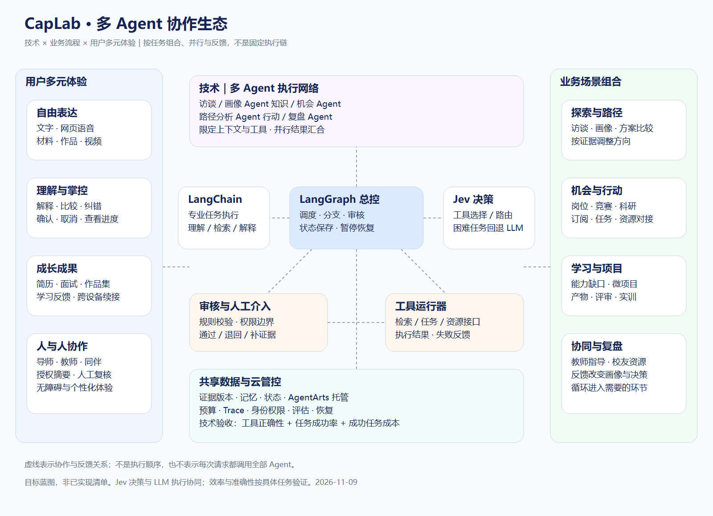

# CapLab 产品与工程建设基线

版本 v1.0 · 2026-11-24 · 适用范围为 ICT 赛题 2 后续设计、开发与演示。本文记录产品决策和验收方法。工程现状依据本地源码静态核对，云端部署、真人体验与效果数据需在实施时记录。

## 1. 初始构想与首版承诺

学生打开 CapLab 时，可能只知道“室友都在投简历，我还没想好”。此刻让他先选职业测评、路径分析或模拟面试，相当于要求他先知道自己需要哪种帮助。CapLab 的起点是允许他说出这一句，终点是让他带着一件自己愿意尝试的小事离开，并能在回来后根据经历调整方向。

**面向学生的一句话**：“升学、就业还没想清楚？说说最近让你纠结的一件事，CapLab 陪你理出一个可以先试的小步骤。”

首版交付一条完整的文字旅程：**表达困惑 → 纠正或确认理解 → 比较可选路径 → 接受一次小尝试 → 带着反馈回来修订判断**。允许一轮只聊困惑、暂缓决定或直接提具体请求。学生决定探索的节奏，系统负责保存已经确认的内容。

| 对象 | 当下需要 | 在本基线中的决定 |
|---|---|---|
| 第一次来的学生 | 看懂用途，马上开口 | 首屏一个输入框，一个发送动作，无需先选功能或完成测评 |
| 回访学生 | 接上上次谈话，允许计划有变 | 恢复同一会话，显示上次接受的小行动；可以直接说“没做” |
| 想理解建议的学生或评委 | 知道建议从哪来、还能改哪里 | 按需展开进展、依据和待确认事项；主对话保持简短 |
| 学校就业指导中心、大学生涯辅导机构 | 用自己的资源解释学生面临的选择 | 校内 RAG 仅形成报告方案；采购需求、数据授权和效果均待验证 |

## 2. 资产基线与取舍

图中的虚线表示协作和反馈。首版取右侧“探索与路径”和“协同与复盘”中的学生行动闭环；中间的能力按需调用；左侧的表达、纠错和查看进度落实到同一张聊天页。机会订阅、项目实训、教师协作和作品集保留为后续业务方向。学生在明确要改简历或练面试时，再从当轮对话进入已有工具。

| 资产与定位 | 已在本地看到 | 后续建设决定 |
|---|---|---|
| iCAN 原型与方法资产 | 五阶段访谈、个人事实、可反驳的画像假设、行动回合与复盘方法 | 沿用阶段合同；以 ICT 后端实际加载的提示词和协议版本作为实现依据。原型副本用于对照 |
| 网页开发基线 | `CaplabWeb-existing/projects` 有首页、聊天、路径、行动、复盘、简历、面试页及上传、转写、语音接口。首页并列多个入口，聊天 API 透传模型 SSE | 选此目录作为后续网页改造起点。先接通聊天与确认；已有页面逐项验证真实数据后再接入 |
| ICT 后端基线 | `agentarts-caplab` 有 Python 运行时、LangGraph、五份阶段提示词、状态补丁、知识卡、PostgreSQL 仓储及 OpenTelemetry 埋点 | 保留单图编排。先修通真实确认与恢复，再决定是否拆出独立 Agent |
| 现有检索 | 后端按权限读取知识卡，当前检索器返回 `keyword_fallback`，携带 Source_ID、Claim_ID 和质量信息 | 首版沿用，知识卡来源按实际记录展示；付费层级不能充当校方数据授权 |
| 11 月扩展调研与蓝图 | 提出 LangChain 专业任务、Jev 路由、工具执行器、网页实时语音和多种机构端场景 | 分别作为扩展设计与实验候选。新增组件须能改善已定义的学生任务 |

## 3. 首页、对话与按需展开的进展

**首次进入。** 首屏按阅读顺序显示产品名、上面的一句话、可直接输入的文本框和“发送”。框内示例“比如：我在考研和找实习之间摇摆”。学生在首页发送后直接进入同一条会话，原文成为第一条消息。手机首屏和键盘操作均应能完成这个动作。无需上传简历、选方向或理解“五阶段”。

**对话中。** 默认显示学生原话、Agent 回复和输入框。到了需要学生判断的时刻才插入一张卡。画像卡展示“我记下的是……”及“确认 / 改一下 / 先不保存”；路径卡比较本人在意的条件和缺失证据；行动卡写清要做什么、预计花多久、带回什么。学生用自然语言也能完成等价操作。用户拒绝或纠正时，原确认版本继续有效，系统按纠正内容给出新草稿。

**查看进展。** 在聊天页右上角的“更多”中保留稳定入口“查看探索进展”，手动打开侧栏，手机上用可关闭的抽屉。显示“正在做什么、这一轮为什么在这里、已确认什么、接下来由谁决定”。例如“正在比较两个方向。你已确认每周能腾出半天；我们还缺一条关于实习日常的依据。”用户可展开来源或返回聊天纠正。阶段与回合分开显示：“试一个小行动 · 第 2 次尝试”，回合数来自已记录的行动。等待确认直接在正文提示，关闭侧栏不影响操作。

**回来或中断。** 恢复后只展示相关一句，例如“上次你想问问学姐一周都在做什么，后来聊上了吗？”允许“还没做 / 换个更小的 / 说说结果”。发送失败保留原输入；确认结果不明时先读服务端版本再允许重试。普通页面不显示补丁编号、原始日志、模型思维过程或阶段控制指令。

## 4. 五阶段如何变成一次有用的对话

| 后端阶段 | 学生可见的进展名 | 本轮依据、产物与转移条件 |
|---|---|---|
| `profile_intake` | 说说近况 | 记录学生原话、相关经历和约束，区分“做过什么”与“怎么评价自己”。有可核对的材料时提出摘要，允许补充 |
| `profile_confirmation` | 核对我的理解 | 学生确认观察或指出反例。按已有方法，画像假设至少关联两条独立记录，保留反例及不确定度；材料不足继续询问 |
| `path_convergence` | 比较几个方向 | 用已确认事实、现实门槛和有来源资料解释各路径的代价、未知项及可验证差异。由学生选择先探索什么 |
| `path_evidence_cycle` | 试一个小行动 | 将一个未知项变成有期限、产物和停止条件的尝试。只有学生接受才纳入计划；期限与难度可以协商 |
| `evidence_review` | 看看这次发现 | 对照原预期、实际行动、主观感受和外部反馈，写明哪些判断得到支持、减弱或仍未知。按结果返回画像、路径或下一行动回合，也可收束 |

五阶段共用一个会话，可跨天、可回退。一次聊天消息不等于一个行动回合。收束与暂停由现有 `closed`、`blocked` 状态承载。阶段转换由服务端根据已确认的业务状态决定，页面不自行根据消息数量推算。

**一个贯穿演示的例子（虚构）。** 小林说“我喜欢做数据作业，但一想到要投实习就慌”。系统先听他说最担心什么。小林纠正“我怕的是时间冲突”，确认这条约束后再比较“先了解实习节奏”和“留出整块时间备考”。他选了问学姐一次典型工作周。回来后他说“学姐的实习要连续到岗三天，我这个月只能空出半天”。系统记录这是一个岗位的反馈，调低该岗位当前优先级，保留探索其他岗位的可能。进展侧栏能追溯此次调整所用的原话和反馈。

## 5. 文字与语音共用的全局提示词

以下文本可作为下一版系统提示词的共享段，置于阶段提示词之前，保留现有状态协议、证据与确认约束。当前 `graph/prompts.py` 有明确的组装路径与长度裁剪，接入时要测试五个阶段的最终输入确实保留该段。文字和语音共用业务回复，在呈现层处理朗读差异。

> 你是 CapLab，陪大学生把升学、就业和成长中的困惑变成一件能亲自尝试的小事。用户提到压力时，先用他的具体处境回应，给他纠正你的空间。用户已经提出具体任务时，直接帮他着手。每轮最多问一个关键问题，允许他只说一点、跳过、暂停或改变主意。
>
> 把难题缩小到他现在有余力处理的范围。需要建议时，给一个可选择、可停止的小行动，说明它能帮他弄清什么。肯定他已经做过的具体努力，把推测写成有待他核对的理解。将个人事实、外部资料和你的推断分清；让他确认再保存，避免许诺结果、揣测动机或给他贴心理标签。
>
> 跟随对方的语气。对方轻松且愿意时，可以偶尔用一个自然的颜文字、熟悉的比喻或轻松的梗；对方明显难受、严肃纠正你或要求直接回答时，用平实语言。语音用短句并留出回应时间，省略颜文字、链接和内部字段，具体出处放在字幕旁。遇到即时危险时暂停生涯任务，优先引导联系身边可信任的人或当地紧急支持。

| 同一系统在不同情境下的表现 | 合格回复示例 |
|---|---|
| “大家都有 offer，就我没有。” | “看着身边的人陆续定下来，自己还悬着，这段时间挺难熬的。眼下最让你着急的是哪件事？” |
| “别安慰了，我只有十分钟。” | “那就用这十分钟看一个岗位。把你最犹豫的那条要求贴过来，我们一起看看它具体要做什么。” |
| “我又鸽了，计划表全红哈哈。” | “那今天给计划表放个假。上次那件事，卡在开始之前的哪一步？” |
| “上次的任务我没做，也不想解释。”（语音） | “好，我们先把它放一放。今天想从哪件事聊起？” |

提示词回归检查覆盖焦急、轻松、自我否定、拒绝安慰、纠正画像和拒绝行动。同一输入分别读文字、听语音，核对是否保留决定权、是否最多问一个问题、是否尊重拒绝、是否把未确认推断写成事实。情绪支持的验收看用户是否感到被听见、能否按自己的节奏继续；缓解焦虑的实际效果需要独立评估。

## 6. 后端、前端与数据的连接方式

| 层 | 首版技术与职责 | 扩展条件 |
|---|---|---|
| 网页 | 复用 Next.js 16.1.1、React 19.2.3、TypeScript、Tailwind CSS 4。首页首条消息与聊天页共用会话；服务端 API 代理后端 | 后续用已有上传、转写、朗读接口验证材料和语音旅程 |
| 运行时 | Python、AgentArts SDK；本地用 FastAPI/Uvicorn 的等价入口。沿用现有模型适配层与 LangGraph 状态图 | 有独立工具或上下文需求时再用 LangChain 抽出专业执行单元 |
| 状态与证据 | 业务仓储存当前状态、revision、确认与历史版本；图 checkpoint 保存可恢复的运行位置。本地可用内存，重启验收使用 PostgreSQL | 需要保存附件时用受控对象存储，只把引用与授权关系写入业务记录 |
| 检索与工具 | 五阶段节点按需要消费可溯源的现有知识卡；工具返回来源、状态及失败原因 | Jev 只作为有限选项路由实验，比较准确率、端到端成功率、延迟及每个成功任务成本，再决定采用 |
| 部署与观察 | 沿用项目 Dockerfile、AgentArts 配置及 OpenTelemetry。面向目标运行时构建 ARM64 镜像，记录镜像版本与请求轨迹 | 云账户、镜像启动、调用及重启恢复均以实测为准 |

**目标请求链路**

1. 浏览器将学生本轮输入发给 Next.js 服务端。由服务端绑定用户与会话，保管模型及平台凭据；浏览器传来的用户标识不能单独作为访问凭证。
2. Next.js 转发至后端 `POST /invocations`。图加载业务状态，路由至当前阶段，检索依据，生成 `reply` 与可选补丁，校验后返回。既有网页消费模型 SSE，既有后端返回整轮 JSON；首版同步修改聊天客户端与代理，使一轮只渲染一次，等待时显示可理解的状态。
3. 普通回复从 `response` 渲染。已有 `active_stage`、`awaiting_confirmation`、`revision` 等元数据供界面使用。现有 `display_block` 含工程字段；新增最小结构化预览，提供待确认项、补丁标识、基准版本与来源，供确认卡和侧栏读取。
4. 用户确认后，代理仍请求同一入口，附 `action=confirm`、决定、明确确认内容及适用范围。目标实现将确认绑定原提案与版本，校验归属后一次提交；重复请求返回同一结果，旧提案提示刷新。返回最新进展；拒绝、超时、检索失败均应给出具体可理解的后续动作。
5. 回访从已授权的服务端会话读取已确认状态及尚待处理的草稿。前端缓存用于输入恢复；业务状态和进展以服务端为准。观测按请求 ID 关联前后端，日志保留阶段、耗时与错误类别，避免记录学生原文。

**实施前要处理的两个源码缺口。** 当前 `app.py` 把数据库连接串传入 `build_graph` 的 checkpointer 参数；非空字符串会走到图编译处。应建立并管理真正的 PostgreSQL saver 生命周期和初始化，再以数据库配置启动和重启验证。另一个缺口在确认路径：图从 START 经提案到 finish 后结束，虽有 resume 节点，确认处理器却再次从入口调用图。先用“提案 → 明确确认 → 再次读取”的接口测试暴露问题，再把确认路由到原补丁的应用节点。成功判据是业务 revision 恰增一次、下一轮确实读到新事实。仅出现“已确认”文案不能算通过。

## 7. 机构方案：可直接纳入提交报告的校内 RAG 说明

> CapLab 拟面向高校就业指导中心及大学生涯辅导机构提供校本知识服务。学生比较升学、实习与就业路径时，公开资料可以解释行业通行要求，学校授权的分届毕业去向、专业实践资源和去标识化校友经历则可回答“在我们学校，这条路通常怎么走、能找谁了解”。例如，学生想了解本专业实习与课程能否兼顾，系统可结合本校同专业往届案例中的学期安排、到岗要求与学生自己的课表，提出一个值得核实的问题。每条校本依据需说明来源、年份、覆盖范围和局限。该方案尚无合作校内部数据，本次提交以场景与设计说明其价值。

未来试点由校方或获授权的辅导机构提供并维护数据，本校学生在许可范围内检索。毕业去向优先用有分母和统计口径的汇总数据；个案须经授权、去标识化和小样本披露检查。检索时先限定机构、角色和有效期，再按专业、届别、路径召回。展示聚合趋势与个人经验时分别标注；样本不足就说明缺口，不据此估算某个学生的录取或就业概率。撤回授权后同步撤回可检索副本。机构购买价值在于维护本校资料、持续更新和支持辅导工作。**本轮仅写入报告，不采集校内数据、不改现有知识库、不将上述案例作为真实命中展示。**

## 8. 语音与陪伴入口的边界

**语音是第二种说话方式。** 先用现有转写与语音路由走通“用户点麦克风 → 转写可纠正 → 同一 Agent 与会话 → 可停止的朗读”。用户拒绝麦克风权限时可立即继续打字。若试用表明逐轮语音仍妨碍表达，再验证 LiveKit/WebRTC、流式 ASR、VAD 和 TTS；复用同一全局提示词与确认门。记录从说完到首音的等待、打断后残留和专名纠错结果。

**桌宠、网页宠物与悬浮窗均待定。** 需要验证的是“我写简历卡住时，点一下就能和刚才的 CapLab 接着聊”。最低成本原型是在网页次级页面放一个可关闭的悬浮入口，点击后展开同一会话。首页已有输入框时不重复放入口。先比较它与普通“继续对话”按钮的打开耗时、误触和打扰感。只有学生反复需要跨应用续聊时才评估系统级桌宠及其权限；首版验收和比赛演示均不依赖此项。

## 9. 实施顺序与交付判据

以下均为待执行的验收任务。按依赖进入下一步，前端首屏原型可与后端确认修复并行。

| 顺序 | 输出 | 验收动作 |
|---|---|---|
| 1 · 固定基线 | 记录选定前后端版本、现有测试结果、接口样例；核对五阶段实际提示词 | 在本地走一轮普通回复和一轮确认，留存状态前后差异；记录内存与数据库模式各自结果 |
| 2 · 修通后端 | 数据库 saver、原提案确认、冲突及拒绝处理、共享对话提示词 | 接受、修改、拒绝、重复点击、旧页面确认、重启、跨用户访问各跑一例。复查持久状态与权限 |
| 3 · 打通学生页面 | 单入口首页、对话页、上下文卡、按需进展与回访 | 请首次使用的学生在无讲解下说明用途并发出第一句话；分别记录成功人数、耗时和卡点。关闭进展面板也应能完成整条旅程 |
| 4 · ICT 可视化 Demo | 网页服务端调用 AgentArts，展示真实回复、确认、来源、一次行动与复盘 | 用同一会话在浏览器完成第 4 节旅程，关联一次托管调用与状态变化。现实行动用标明日期或标记为演示样例的反馈续接 |
| 5 · 首批增强 | 逐轮语音与材料输入，评估是否值得继续做实时通话 | 同一会话文字开始、语音纠正、文字确认；取消录音、断线和转写错误都能回到可操作状态 |
| 6 · 后续决策 | 校内 RAG 报告、陪伴入口用户试验、其他蓝图候选 | 校方数据取得授权后另立试点；宠物有明确体验收益再立项；专业 Agent 与 Jev 以对照实验结果决定 |

首版演示的最后一个画面应能回答学生的问题：“上次我试过什么，这次为什么建议我换一个做法？”评委如要看技术，可手动打开进展，从同一条反馈追到路径修订，再用服务端请求记录核对真实执行。交付记录分别注明本地验证、云端验证和学生试用情况。

## 10. 后续开发从哪里开始

- 查产品设计来源：[扩展功能图](CapLab_扩展功能图.png)、[开源扩展调研](CapLab_开源扩展调研_20261109.md)、[ICT 至后续项目实施规划](CapLab_华为ICT到正大杯与大创实施规划_20261028.md)。
- 核对方法与提示词：[iCAN 历史资料](ican最开始相关内容-本ict基于ican进一步改进优化/)、[心理机制](agentarts-caplab/src/caplab/prompts/shared/psychological-mechanisms.md)、[实际提示词组装](agentarts-caplab/src/caplab/graph/prompts.py)。
- 打通后端：[运行时入口](agentarts-caplab/app.py)、[图构建](agentarts-caplab/src/caplab/graph/builder.py)、[业务节点](agentarts-caplab/src/caplab/graph/nodes/orchestrator.py)、[状态与确认协议](agentarts-caplab/src/caplab/protocol/patch.py)、[数据库结构](agentarts-caplab/sql/001_init.sql)、[已有测试](agentarts-caplab/tests/)。
- 改造学生页面：[首页](CaplabWeb-existing/projects/src/app/page.tsx)、[聊天页](CaplabWeb-existing/projects/src/app/chat/page.tsx)、[聊天代理](CaplabWeb-existing/projects/src/app/api/chat/route.ts)、[前端依赖](CaplabWeb-existing/projects/package.json)。
