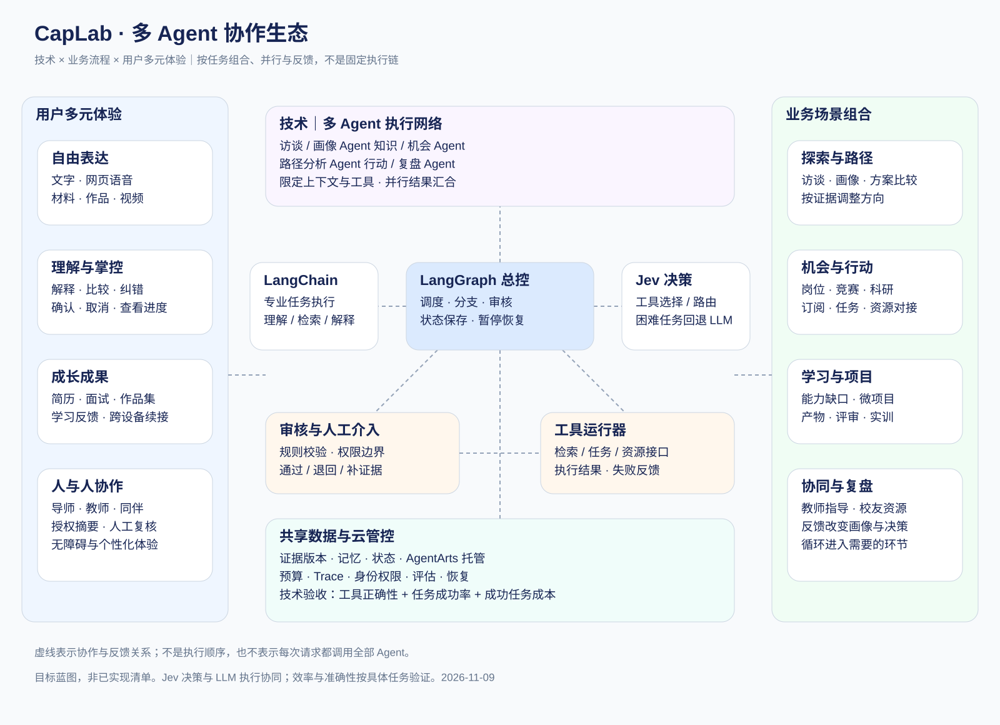
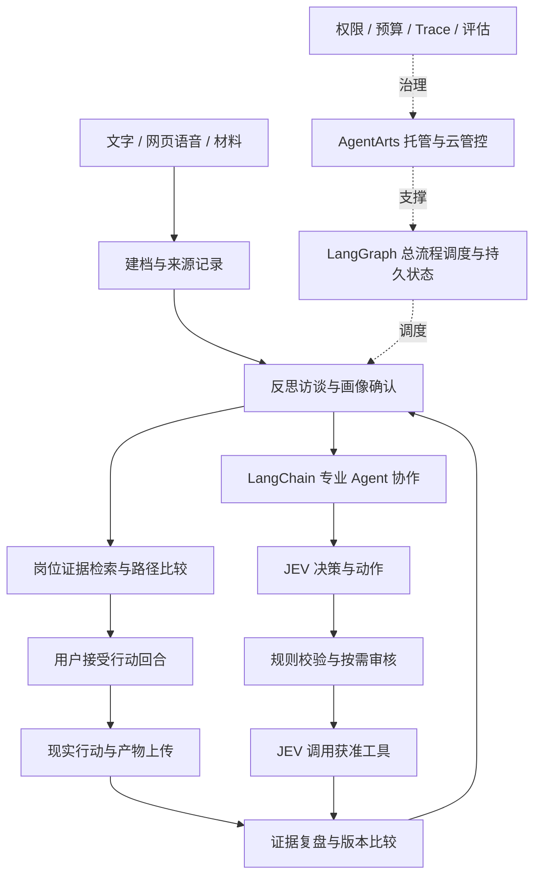

# CapLab 开源扩展调研与 ICT 落地方案

检索日期：2026-11-09。本文为规划建议。检索覆盖官方仓库、厂商文档和技能目录，并非穷尽全网。

## 1. 扩展总纲：技术、业务流程、用户多元体验

将 CapLab 的扩展空间定位为“面向大学生成长、探索与实践的智能体平台”。网页语音只是交互能力之一，不能代表产品全部。保留已有循证生涯探索主线，同时向机会发现、能力成长、项目实践、资源协作、长期陪伴与机构运营扩展。下文区分完整能力蓝图和比赛首期切片。

可选的比赛首期组合（不是最终产品边界）：**现有 Next.js 前端 + LangGraph 总流程编排 + LangChain 专业 Agent + JEV 决策与工具执行接口 + AgentArts 托管 + PostgreSQL 证据存储 + LiveKit 网页语音**。OCR、向量检索和运行监控按需添加；实时视频、多集群治理放到后续。技术价值应落在“断线能续、事实可查、行动可验、结论能改”。


### 1.1 三条扩展主线

| 主线 | 要回答的问题 | 扩展内容 | 验收依据 |
|---|---|---|---|
| 技术 | 系统怎样可靠协同并完成动作？ | LangGraph 总控、LangChain Agent、JEV 决策与工具调用、多模态、记忆、检索、云管控 | 状态恢复、工具成功率、审核覆盖、延迟与成本 |
| 业务流程 | 从用户需求到实际结果怎样形成闭环？ | 建档、访谈、证据核验、路径决策、审核、任务执行、反馈复盘、重规划 | 来源可查、交接完整、动作可验收、结论可修正 |
| 用户多元体验 | 不同用户如何参与并获得价值？ | 文字/网页语音/作品交互、路径比较卡、进度看板、简历面试、导师协作、无障碍与跨设备续接 | 任务完成率、纠错成本、可理解性、用户控制权 |

每项扩展应同时说明三面：例如“机会雷达”的技术是检索 Agent 与定时工具，流程是筛选—审核—订阅—跟进，体验是解释性机会卡与截止提醒。网页语音只是体验入口与多模态技术的一项，不限定整个产品。

## 2. 已有资产与真正缺口

本轮阅读了 `ican/CapLabAgent/projects/README.md`、`package.json`、`ican/04_知识库与规划/CapLab整体规划架构与流程图_v0.3.md` 和 ICT 目录的 20261028 实施规划。以下是文档基线，不是线上验证或完整源码审计；工作区有多个副本，开发前须冻结唯一基线。

| 现有文档描述 | 扩展切口 |
|---|---|
| Next.js 聊天，文本、图片和部分文档解析 | 加网页通话和扫描件结构化提取，不重复建设图片上传 |
| 五阶段提示词与业务规划 | 把阶段、确认、回退写成持久状态机 |
| 浏览器本地单会话与滚动摘要 | 增加账号、跨设备恢复、事实版本和长期证据 |
| 词匹配材料片段，无正式向量知识库 | 建设带日期、出处和适用范围的岗位资料库 |
| 旧路径、面试等页面含示例 | 接通真实证据和任务后再作为正式功能展示 |
| 本地 ICT 规划选择赛题2 AgentArts | 保持该路线，Nexent 作为比较与备选，不擅自换赛题 |

## 3. 开源候选与如何借鉴

下表链接均在本轮访问过。许可是筛选级信息：代码、模型权重、训练数据、云服务可能分别授权；正式引入时必须锁定版本并检查对应 LICENSE/模型卡。未经实测，不把官方性能数字作为 CapLab 指标。

| 项目与一手来源 | 可借鉴能力 → CapLab 落点 | 优先级与限制 |
|---|---|---|
| [LangGraph](https://github.com/langchain-ai/langgraph) | 状态图、持久化、人工介入 → 五阶段、画像确认、等待行动、恢复复盘 | P0；MIT 核心。业务权限、幂等和证据规则仍需自己实现 |
| [LiveKit Agents](https://github.com/livekit/agents) | 实时音视频 Agent → 网页访谈、语音面试、可打断回复 | P1；Apache-2.0。媒体服务器、模型推理和托管服务分别核算 |
| [Pipecat](https://github.com/pipecat-ai/pipecat) | 实时音视频处理管线 → ASR/LLM/TTS 模块化替换 | P1 备选；BSD-2-Clause。与 LiveKit 二选一作为主框架，先做同场景样例比较 |
| [FunASR](https://github.com/modelscope/FunASR) | ASR、VAD 等 → 中文转写、断句、语音输入 | P1；工具代码与各模型授权分别检查，选流式模型并实测口音和专有名词 |
| [MOSS-TTS](https://github.com/OpenMOSS/MOSS-TTS) | 语音生成与流式方向 → 自然语音反馈 | P1 候选；按选中子模型检查授权与推理方式，TTS 本身不等于完整双向对话 |
| [MOSS-TTS-Nano](https://github.com/OpenMOSS/MOSS-TTS-Nano) | 轻量语音生成 → 低预算网页通话试验 | P1 候选；官方强调 CPU 实时方向，实际中文首包延迟、音质和并发待测 |
| [MOSS-VL](https://github.com/OpenMOSS/MOSS-VL) | 开放权重视觉/视频理解 → 学生讲解作品时辅助理解画面 | P2；不要把开放权重直接等同所有用途无限制开源；11B 系列资源成本需评估 |
| [PaddleOCR](https://github.com/PaddlePaddle/PaddleOCR) | 图片和文档结构提取 → 成绩单、证书、扫描简历 | P1；Apache-2.0 代码。识别结果保留原图定位，数字由用户核对 |
| [pgvector](https://github.com/pgvector/pgvector) | PostgreSQL 向量检索 → 岗位、课程、案例语义召回 | P1；PostgreSQL License。需要另选 embedding；召回不是事实核验 |
| [Langfuse](https://github.com/langfuse/langfuse) | Trace、评估、模型调用观测 → 比赛展示可解释执行链 | P1；核心开源与企业功能边界分别检查，日志先脱敏 |
| [Prometheus](https://github.com/prometheus/prometheus) | 时序指标与告警 → 延迟、错误率、并发和服务健康 | P1；Apache-2.0，不保存学生全文到指标标签 |
| [OPA](https://github.com/open-policy-agent/opa) | 策略判定 → 教师可见范围、工具权限、操作门禁 | P2；Apache-2.0。小规模先做清晰的服务端权限，不必立即引入策略服务 |
| [Cloud Custodian](https://github.com/cloud-custodian/cloud-custodian) | 规则式云资源治理 → 借鉴资源标签、预算巡检、闲置检测 | P2；Apache-2.0。未验证华为云资源覆盖，不能承诺直接接入即可管控 |
| [Karmada](https://github.com/karmada-io/karmada) | Kubernetes 多集群编排 → 多校/多区域容灾研究 | P3；Apache-2.0。单校原型不需要多集群，运维成本明显增加 |
| [Nexent](https://github.com/ModelEngine-Group/nexent) | 工具、知识、记忆和编排的平台化设计 → 借鉴管理后台与工具生命周期 | P2 参考；按仓库 LICENSE 核查。不是 AgentArts 的同名替代物，不与赛题2要求混用 |

基础优先验证 LangGraph 与持久证据模型，再从下述业务方案选择一个比赛主场景。语音场景选中后才验证 LiveKit、FunASR、MOSS-TTS-Nano，不让交互技术决定产品边界。

## 3A. 面向整个 CapLab 的扩展蓝图

这些是产品设计推演，不是仓库已经提供的完整生涯功能。复用的是具体技术和机制，需要自行完成领域适配。

| 能力域 | 用户可以做什么 | 开源参考与复用点 | 适配与验收 |
|---|---|---|---|
| 长期成长记忆 | 跨学期保留目标、约束、作品和决策变化 | [Mem0](https://github.com/mem0ai/mem0)：记忆提取与更新机制 | 记忆候选须经用户确认；修改事实后旧版本不能继续主导推荐；不与 checkpoint 混淆 |
| 职业与能力知识网络 | 从岗位反查能力、课程、项目和校友经历 | [Microsoft GraphRAG](https://github.com/microsoft/graphrag)：关系抽取、图索引与检索 | 先用小型人工核验关系表建立基线，再验证图检索是否优于普通 RAG；关注索引成本 |
| 主动机会雷达 | 查找实习、竞赛、科研、志愿服务并解释匹配原因 | [Browser Use](https://github.com/browser-use/browser-use)：浏览器信息采集 | 优先官方 API/RSS；仅对允许来源做只读采集，保留截止时间与页面证据；报名由用户确认 |
| 个性化学习教练 | 把能力缺口变成学习任务、练习与阶段反馈 | [Moodle](https://github.com/moodle/moodle)：课程、活动和学习记录 | 可通过接口对接，避免整体重建 LMS；完成课程不自动认定掌握能力 |
| 项目实践工作台 | 拆解真实项目、提交产物、获得评审和复盘 | [OpenHands](https://github.com/OpenHands/OpenHands)：工具执行与开发任务机制 | 仅在隔离实验环境辅助代码类项目；明确学生与 AI 的贡献，不能把代做产物当能力证据 |
| 导师与伙伴协作 | 预约咨询、分配导师、团队任务和反馈 | [Cal.diy](https://github.com/calcom/cal.diy)：预约机制；原 cal.com 链接本轮重定向至此 | 日历时区、取消和角色权限需测试；导师匹配规则由 CapLab 实现，仓库不自带生涯匹配 |
| 教师运营工作台 | 维护任务模板、复核资料、追踪干预效果 | [Flowise](https://github.com/FlowiseAI/Flowise)：可视化流程交互参考 | 借鉴编辑体验；核心执行仍统一在 LangGraph，避免双套编排状态不一致 |
| 机构资源管理 | 管理项目机会、导师、课程与试点记录 | [NocoDB](https://github.com/nocodb/nocodb)：表格式后台设计参考 | 自托管不等于宽松开源；该类项目须逐版本核查商业/源码许可，暂不列为直接复制代码优先项 |

以上新增仓库只做了官方页面初筛，未完成固定版本许可证和依赖审计。正式选型再核查；对 Moodle 等 copyleft 项目及含企业目录项目，优先明确接口集成与代码复用的差别。

### 四个可独立成立的 ICT 展示场景

| 方案 | 核心闭环 | 技术抓手 | 可验证价值 | 实施复杂度 |
|---|---|---|---|---|
| A：机会发现与行动执行 | 个人目标 → 官方机会检索 → 解释匹配 → 行动追踪 | LangGraph + 检索 + 定时任务 + 云端运行 | 机会是否真实、过期是否更新、任务是否落地 | 中 |
| B：能力成长与项目实训 | 岗位能力缺口 → 微项目 → 作品评审 → 能力证据更新 | 图检索 + 项目沙箱 + 证据版本 | 对同一能力主张能否提供前后作品和真实反馈 | 中高 |
| C：校级协同指导 | 学生需求 → 授权摘要 → 教师复核 → 资源转介 → 反馈 | 多租户权限 + 工作流 + 管理看板 | 授权隔离、复核耗时、问题闭环率 | 中高 |
| D：多模态生涯交互 | 网页语音/文字/作品输入 → 路径讨论 → 行动复盘 | LiveKit + ASR/TTS + 视觉理解 | 输入便利性、语音质量、证据纠错 | 中 |

建议把 A 或 B 作为业务主故事，D 作为可选交互亮点，C 作为校方应用延伸。最终选择需要真实学生需求、团队能力与比赛时间支撑；这里不把网页语音预设为唯一优先功能。

### 进一步发散，但暂不进入首期

- **决策实验室**：模拟城市、预算、家庭约束变化，显示推荐为何改变，不伪造未来结果概率。
- **同伴互助网络**：按真实项目、时间与技能互补匹配伙伴，双方同意后共享必要资料。
- **校友路径案例库**：把经验拆成背景、关键行动、成本和失败条件，减少“成功故事照抄”。
- **成长作品集与求职材料**：由证据库生成简历草稿、面试案例与作品索引，禁止无据量化。
- **校园服务导航**：连接课程、实验室、就业指导与竞赛资源；外部预约、投递和报名要有明确确认步骤。
- **研究评估平台**：冻结干预版本、记录过程指标、开展经同意的试点，区分使用满意度与真实成长效果。

## 4. 网页语音通话：一项交互扩展的具体实现

### 用户体验

聊天页提供“开始语音”按钮，用户授权麦克风后进入通话；显示连接状态、实时字幕、静音、结束通话和文字输入。AI 说话时用户可以打断；专业名称和数字可在字幕中纠正。通话结束输出待确认的事实卡和行动卡，用户确认后入库。

### 推荐链路

`浏览器麦克风 → WebRTC / LiveKit → VAD + 流式 ASR → LangGraph → LLM → 流式 TTS → 浏览器扬声器`。

[LiveKit 官方 LangChain 集成](https://docs.livekit.io/agents/models/llm/langchain/)可作为 LangGraph 接入起点。仍要自行验证图的流式输出、工具事件和取消语义，不把连接成功等同业务集成完成。

先使用分段 ASR—LLM—TTS 管线，便于追踪错误与更换模型。端到端全双工模型后续再比较。每个语音回合带 `turn_id`；打断时停止旧音频、取消旧生成，避免旧回复继续播报；文字与语音共享会话状态，但临时 ASR 结果不直接变为已确认事实。网络断开后恢复最近提交的状态，失败时保留文字入口。

LiveKit 媒体服务和 ASR/TTS 推理服务独立部署；不要假设 AgentArts 运行时直接承载 WebRTC UDP 媒体或模型 GPU 推理。需实测网络连通、TURN、浏览器回声消除和服务端签发短期房间令牌。

### 三个高价值场景

1. **生涯访谈**：学生说“我不知道适合什么”，系统追问具体经历，复述事实与假设，等确认再形成画像。
2. **模拟面试**：依据真实岗位要求追问作品和行为证据，评价回答完整性、证据充分度与表达结构，不凭声音推断人格或职业潜力。
3. **行动后复盘**：学生口述访谈、兼职或项目体验，关联上次任务，指出新证据改变了哪项路径判断。

## 5. 多 Agent 架构：LangGraph 管流程，专业 Agent 执行任务

建议节点：`intake → dialogue → confirm_profile → compare_paths → confirm_plan → design_cycle → wait_evidence → review → replan`。事实冲突回到建档；画像理解有误回到访谈；新证据只影响路径时只重跑比较。

核心状态包括：用户与会话标识、当前阶段、证据 ID、确认画像版本、路径版本、行动任务、待确认事项、运行状态。原始媒体存对象存储；状态中保存引用和摘要。事实记录应区分用户陈述、材料支持、AI 假设、已确认与已否定，并保留来源、时间和修改理由。

Checkpointer 负责流程恢复，业务表负责事实版本，二者不是同一个概念。持久化后测试服务重启、重复提交和并发回调；以业务幂等键避免重放时重复生成任务。教师复核与用户确认可用 interrupt/resume，但调用方身份必须由服务端验证，不能只凭 thread_id 访问。

采用多 Agent 形式，由一个顶层 LangGraph 统一管理阶段与状态，各专业 Agent 作为节点或子图执行任务。五阶段是业务流程，Agent 是专业职责，二者不必一一对应；同一个检索 Agent 可以服务建档、路径比较与复盘多个阶段。


### 5.1 控制层、执行层与工具层

**LangGraph 是整体业务流程管理者**：依据状态和已定义路由规则决定下一步执行单元、并行与汇合、何时进入审核、何时暂停或恢复，并通过持久化保存运行状态。它是编排框架，不必另包装成一个自由对话的“大脑 Agent”。

**LangChain Agent 是执行单元的实现方式**：在限定上下文和工具范围内完成语言理解、检索、推理与解释生成，返回结构化结果供总图继续调度。Agent 内部也可以循环调用工具，但不能绕过顶层阶段门禁。LangGraph 与 LangChain 的区别是本项目的职责分层，并非技术上互斥；官方支持在自定义流程中组合确定性逻辑与 Agent 行为。[LangGraph 概述](https://docs.langchain.com/oss/python/langgraph/overview)、[LangChain Agents](https://docs.langchain.com/oss/python/langchain/agents)、[多 Agent 模式](https://docs.langchain.com/oss/python/langchain/multi-agent)。

**Jev 是已有研究的决策模型**，可承担候选工具选择、路由等有明确选项的决策。此前因本地没有定义而将其视为未明确模块，现依据公开研究修正。工程上由 Jev 选择动作，工具运行器负责实际 API 调用，LangGraph 管理前后状态和审核；“Jev 调用工具”是这条集成链路的简称，不意味着模型本身执行外部接口。

研究依据与适用边界：

- [JevAgentHarness（2026-10，预印本）](https://arxiv.org/abs/2610.21412)研究决策模型与 LLM 共享控制，并通过按决策校准阈值、低置信时回退 LLM 保持任务成功率。摘要中的 81.1–89.0% 成本下降与最高 2.5 倍加速，属于该研究训练的 4B 模型在类似训练分布任务上的结果，不能直接写成 Jev 或 CapLab 的已验证收益。
- [Jev 工作流实证研究（2026-10，预印本）](https://arxiv.org/abs/2610.13092)在五种 Agent、4500 次任务执行中发现决策成本和延迟降低，但端到端收益随工作流变化，部分移动 Agent 成功率下降。因此有“更高效决策”的依据，但没有“任何工具调用场景都更准确”的普遍保证。
- CapLab 将 Jev 作为重点技术候选：先评估工具选择、Agent 路由和资料相关性等有限选项任务。对照完整 LLM 决策、Jev 决策、Jev+LLM 回退三组；同时测准确率、任务成功率、延迟和每个成功任务总成本。阈值用独立验证集校准，不直接把模型分数当正确率。

Jev 的研究存在与模型权重是否开源是两回事；本轮尚未核实可自托管权重与许可，不将它列为已核实开源模型。以下动作契约仍为 CapLab 建议接口。

| 专业执行单元 | 主要职责 | 输出与交接 |
|---|---|---|
| 访谈/画像 Agent | 理解需求、澄清约束、提取待确认事实 | 画像候选、未知项、确认请求 |
| 知识/机会检索 Agent | 查找岗位、课程、项目与公告 | 带来源、时间和适用范围的证据 |
| 路径分析 Agent | 综合约束与证据，解释候选方案 | 方案比较、成立条件、证据缺口 |
| JEV 决策与执行模块 | 形成决策并提出或执行相应工具动作 | 决策记录、动作参数、执行结果；由决策模型与工具运行器组成 |
| 审核 Agent | 检查事实支持、规则与前后矛盾 | 通过/退回/请求人工审核及理由 |
| 行动/复盘 Agent | 将决策转为任务，整理反馈并建议更新 | 行动卡、验收结果、重规划建议 |

### 5.2 决策到工具执行的闭环

`LangGraph 调度 → 专业 Agent 提供证据与方案 → JEV 形成决策/动作 → 规则校验 → 按动作类型审核 → JEV 调用获准工具 → 回写结果 → LangGraph 决定复盘或下一步`。

只读检索等低风险工具可在授权范围内直接执行；报名、投递、预约、对外发送或云资源变更等有外部效果的动作，按规则进入用户/人工确认。审核 Agent 的语言判断不能替代代码级权限验证。工具失败返回明确状态，不应直接宣称任务完成。

建议动作字段：`decision_id、action_id、tool_name、arguments、evidence_refs、approval_status、idempotency_key`；返回 `status、result_ref、error、executed_at`。这些是建议契约，非现有 JEV API。LangGraph 保存流程进度，业务库保存决策与证据，工具日志记录动作结果。

Agent 只获得任务所需上下文，提交状态更新建议，由图节点按规则合并；并行检索结果先汇合和去重再进入决策。共享字段需明确合并策略，防止多个 Agent 覆盖用户确认内容。对同一动作设置幂等键、超时和有限重试；重新运行审核不得重复预约或投递。

### 5.3 三方面联合验收

- 技术：中途重启能恢复；重复动作只执行一次；未获准的工具不可调用；可追踪每个 Agent 的输入、输出与版本。
- 业务：证据不足能退回补充；审核不通过能定位理由；执行失败能调整计划；新反馈能改变已有决策。
- 体验：用户知道目前在做什么、为何等待、需要确认什么；可以纠正画像、取消动作，并在文字与网页语音间继续同一任务。

## 6. 云管控与 ICT 适配

按本地规划继续研究 AgentArts 高代码路线。官方提供[运行时 SDK 快速开始](https://support.huaweicloud.com/highcode-agentarts/agentarts_10_040.html)与[CLI](https://support.huaweicloud.com/highcode-agentarts/agentarts_10_039.html)。本轮页面注明镜像构建的 ARM64 要求，不能直接假定现有 x86 镜像可运行；以当前账户区域和运行时要求验证。

| 管控维度 | CapLab 实际用途 | 比赛证据 |
|---|---|---|
| 托管与发布 | 业务 Agent 镜像、版本、健康检查、回滚 | 实际平台资源与调用记录 |
| 身份与权限 | 学生只见自己记录；教师只见授权摘要 | 两个测试账号交叉访问被拒 |
| 存储与恢复 | PostgreSQL 状态、对象存储材料、备份 | 重启后继续未完成任务 |
| 模型预算 | 单会话 token、语音分钟、并发配额 | 同一任务的成本拆分与超限行为 |
| 可观测性 | trace_id 关联语音、检索、图节点和模型 | 一次失败可定位到具体步骤 |
| 数据治理 | 用户删除、保留期限、日志脱敏 | 删除后检索/缓存不再返回该材料 |
| 扩缩容 | 业务与媒体、模型服务分开扩容 | 固定并发下延迟和错误率曲线 |

华为云托管产品不是开源项目；采用开源业务框架不意味着云资源免费。成本拆为计算、模型推理、存储、流量与监控。暂不列未经验证的具体价格。

赛事规则仍需以本届报名系统附件为准。本轮没有核验完整评分表、当前账户额度及区域开通状态，因此不承诺某架构必然符合赛题。Nexent 相关路线与 AgentArts 路线分别评估，避免用另一个赛题的技术栈替代已选路线。

## 7. 更全面的功能发散

| 方向 | 可落地功能 | 与主线关系 | 顺序 |
|---|---|---|---|
| 多模态材料 | 扫描简历、成绩单、作品截图提取并定位来源 | 增强建档证据 | P1 |
| 机会雷达 | 用户订阅岗位/竞赛方向，定期核查官方公告变化 | 补充现实行动机会，过期自动标注 | P2 |
| 证据作品集 | GitHub 项目、文档、反馈与能力主张绑定 | 展示可验证产物，不等同自动认定作者贡献 | P1 |
| 岗位能力图 | 岗位要求—课程—项目任务—能力证据关联 | 将准备度拆成可行动缺口 | P2 |
| 情景比较 | 城市、预算、升学/就业条件变化后的路径比较 | 显示假设敏感性，不输出虚假成功概率 | P1 |
| 教师协作 | 学生授权摘要、重点问题、批注与人工转介 | 保留教师判断和学生控制权 | P2 |
| 校级看板 | 去标识化的共性困惑与服务需求统计 | 辅助指导资源配置，不做学生优劣排名 | P2 |
| 真实任务库 | 生涯访谈、作品试做、岗位观察的模板与验收 | 延续证据回合，避免只有建议没有行动 | P0 |
| 可访问性 | 字幕、键盘操作、文字与语音切换 | 改善使用门槛 | P1 |
| 视频讲解 | 作品演示时选择性传帧、画面问答 | 检验作品理解，避免常开摄像头与情绪打分 | P3 |

## 8. find-skills 筛选结果

先查看 [skills.sh 目录](https://skills.sh/)，再运行 `npx skills find langgraph`。以下来自 LangChain 官方组织 [langchain-skills](https://github.com/langchain-ai/langchain-skills)，本轮仓库显示约 1.3K stars、MIT，README 提醒尚处早期开发。安装量为检索快照，不代表代码安全或稳定性；CLI 与网页缓存略有差异。

| Skill | CLI 安装量快照 | 对本项目用途 |
|---|---:|---|
| [langgraph-fundamentals](https://skills.sh/langchain-ai/langchain-skills/langgraph-fundamentals) | 18.9K | 阶段图、状态与路由 |
| [langgraph-persistence](https://skills.sh/langchain-ai/langchain-skills/langgraph-persistence) | 18.8K（网页约18.7K） | 会话持久化与恢复 |
| [langgraph-human-in-the-loop](https://skills.sh/langchain-ai/langchain-skills/langgraph-human-in-the-loop) | 18K | 用户确认与教师复核 |

可选安装命令（本轮未安装）：

```sh
npx skills add langchain-ai/langchain-skills --skill langgraph-fundamentals
npx skills add langchain-ai/langchain-skills --skill langgraph-persistence
npx skills add langchain-ai/langchain-skills --skill langgraph-human-in-the-loop
```

这些是帮助开发者实现系统的技能，不是给 CapLab 安装后自动获得语音、数据库或云管控的运行时插件。现有生涯业务 Skill 应保留证据约束，再迁移成节点逻辑与验收规则。

## 9. 以场景 D 为例的实施顺序与验收（可替换业务切片）

以下是工程建议，不是已测成绩或赛事官方阈值。估计以熟悉现有代码的小团队为前提，平台权限和模型部署可能增加工期。

| 阶段 | 范围 | 建议验收 |
|---|---|---|
| 第1周 | 冻结代码基线；五阶段状态、账号与持久化 | 10条典型旅程可恢复；事实未确认不能升级为已确认 |
| 第2周 | 岗位来源、行动卡、复盘版本比较；AgentArts 最小部署 | 每条路径建议有来源或明确标为假设；展示真实托管调用 |
| 第3周 | LiveKit 网页通话；ASR/TTS；字幕与打断 | 30轮中文测试记录首音延迟 P50/P95、识别纠错、打断残留与掉线恢复 |
| 第4周 | OCR、监控、评估和完整演示 | 扫描件字段对照人工核验；跨账号隔离；重复提交不重复写入 |

语音可先设安静网络下 P95 首音延迟≤2.5秒、打断后停播≤500毫秒作为试验目标；统一从用户说完到首个可听音频计时，分别报告网络/ASR/LLM/TTS耗时。达不到时优化分块与模型，不篡改测量口径。

核心比较：文字基线、语音版本、语音+证据闭环版本完成同一任务。评估事实错误、来源可追溯、行动卡完整性、状态恢复和单位会话成本。学生真实效果需要后续研究，工程角色扮演不能证明提升就业率或缓解焦虑。

建议演示：学生网页通话提出困惑 → 上传作品截图 → 确认画像 → 比较两条路径 → 接受一个真实探索任务 → 上传反馈 → 系统修正原结论 → 展示执行轨迹与成本。临场等待无法完成的现实行动用明确标注的历史样例续接，不伪装实时发生。

## 10. 扩展功能图

下图为目标规划，全部扩展项均不表示已经上线。P0为比赛核心，P1为首批增强，P2/P3为后续探索。



可编辑业务流程：



## 11. 待验证清单

- 当前赛题2高代码提交要求、账户权限、区域和额度。
- AgentArts ARM64 镜像与选定依赖兼容；模型服务另行验证硬件支持，不宣称已适配昇腾。
- LiveKit 自托管网络、TURN 和浏览器通话质量。
- MOSS/FunASR 所选模型的授权、内存、中文质量和流式接入。
- 具体版本许可证、依赖清单、上游维护活跃度及已知问题；本轮没有完整供应链审计。
- 开发基线与线上版本一致性；本轮只新增研究文档和功能图。

### 蓝图阅读方式

功能图采用中心协作网络：LangGraph 是共享调度与状态中心，专业 Agent 按任务选择性激活；Jev 辅助局部决策；业务场景按需组合能力；多元体验是跨场景入口。连线表示协作和反馈，不代表每次请求都执行所有节点。支持并行检索、条件分支、审核退回、暂停恢复与复盘循环。
